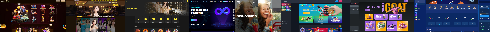

# Chaya Wolfe 
### `Full-Stack Engineer | AI 🤖 | iGaming 🎰 | Sportsbook ⚽ | Blockchain ⛓️ | Web3 & NFTs 🚀` 

  
  
  
  

 

---

---

### About Me

I'm a **Senior Software Engineer** with extensive experience in full-stack development, building scalable web applications, backend systems, and technology-driven business solutions.

My work spans **iGaming, sports betting, online casinos, blockchain, trading platforms, cryptocurrency exchanges, AI, and AI-powered applications**. I enjoy turning complex business ideas into reliable, high-performance software.

<pre>
Full-Stack Development ─────┐
                            │
iGaming & Sports Betting ───┤
                            │
Blockchain & Web3 ──────────┤
                            │
Trading & Exchanges ────────┼──► Scalable Technology
                            │    & Real-World Solutions
AI & AI Training ───────────┤
                            │
Automation & APIs ──────────┘
</pre>

## 🛠️ Technologies & Interests

- **Frontend:** React, Next.js, TypeScript, JavaScript
- **Backend:** Node.js, Express.js, REST APIs
- **Databases:** MongoDB, PostgreSQL, MySQL
- **Blockchain:** Web3, smart contracts, decentralized applications
- **iGaming:** Sportsbooks, casino platforms, betting systems, game integrations
- **Trading & Exchanges:** Trading applications, exchange integrations, financial technology
- **AI:** AI-powered applications, LLM integrations, AI training workflows, automation
- **DevOps:** Git, GitHub, Docker, Linux, CI/CD

